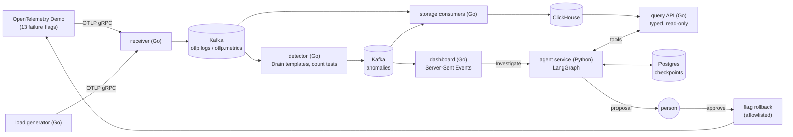

# Drishti

[](https://github.com/dhanush-cn/drishti/actions/workflows/ci.yml)

Drishti is an observability pipeline in Go and an AI investigator in Python. The pipeline takes OpenTelemetry logs and
metrics from a running microservices app, stores them in ClickHouse and raises alerts within seconds. When an alert
fires, a LangGraph agent works out which service caused it, using typed queries against the stored telemetry, and
proposes a fix that waits for a person to approve it.

**[Watch one live run](https://youtu.be/Q3YHTMzR-wU)** (2:47): a fault is switched on, the detector alerts, the agent
diagnoses it, a person approves the fix and the recovery is checked. One run, not an accuracy measurement.

**[Step through recorded investigations](https://dhanush-cn.github.io/drishti/)**: real runs on a recording the agent
was never tuned on, including the ones it got wrong.

Detection is plain code: it is predictable, fast and cheap. The agent is used only for diagnosis, where the signals
are ambiguous and a fixed rule isn't enough. Every number below was measured on one laptop and links to the doc section
that records how, weaknesses included.

## Architecture



- **Ingest:** the receiver acknowledges an OTLP request only after Kafka has it, and pushes back with a retryable error
  when Kafka is slow, so the backlog stays in the sender rather than in memory
  ([receiver.md](docs/receiver.md#4-backpressure-bounded-wait-then-retryable-rejection-the-backlog-lives-in-the-sender)).
- **Storage:** batches per Kafka partition, inserted in the background. Each part records the Kafka offsets it holds,
  so a restarted consumer skips what is already stored: exactly once into ClickHouse
  ([storage.md](docs/storage.md#1-exactly-once-into-clickhouse-the-offsets-live-in-the-part)).
- **Detection:** log lines become templates (Drain). Counts per template and per span are tested against a moving
  baseline with an overdispersed-Poisson test, plus one memory-trend rule. No ML
  ([detector.md](docs/detector.md#3-one-statistical-primitive)).
- **Two paths from Kafka:** ClickHouse wants large batches, and large batches delay queries, so the live dashboard
  reads Kafka directly and never waits for storage.

## Measured results

Internal: one laptop (HP Victus 15, Core 7 240H, 24 GB, WSL2), one person's runs. Each table links to the doc section
with its setup, raw data and what limited it.

### Ingest and storage

Pass/fail thresholds are still provisional ([benchmarks.md](docs/benchmarks.md)); runs are 3 repeats unless stated.

| Target | Result | Source |
|---|---|---|
| Sustain 50k events/s (stretch 200k) | Receiver alone: **275k records/s** sustained, ×3; fails at 300k | [benchmarks §3](docs/benchmarks.md#3-receiver-knee-patches-19-21-23) |
| | Full path (receiver → Kafka → ClickHouse): **100k records/s** keeps up, ×3 | [storage.md, 25 Oct](docs/storage.md#measured-25-oct-laptop-internal-patch-26-1e70af8-3-runs-per-configuration) |
| | Storage draining a backlog: **241k rows/s** with all 6 partitions busy (median of 3) | [storage.md, 25 Oct](docs/storage.md#measured-25-oct-laptop-internal-patch-26-1e70af8-3-runs-per-configuration) |
| Event → queryable, p99 < 5 s | **2.05–2.84 s** at 100k records/s | [storage.md, 25 Oct](docs/storage.md#measured-25-oct-laptop-internal-patch-26-1e70af8-3-runs-per-configuration) |
| 3× burst for 60 s, zero loss | **0 lost, 0 duplicated**, ×3; backlog cleared 24–35 s after the burst | [benchmarks §5](docs/benchmarks.md#5-burst-patch-24) |
| Crash: no loss, recovers by itself | `kill -9` of the storage consumer: **0 lost**; longest gap without inserts 10.3 s, including a deliberate 5 s wait before the restart | [benchmarks §2](docs/benchmarks.md#2-failover-patch-18) |

### Detection

The OpenTelemetry Demo's 13 failure flags, switched on one at a time on live traffic (run B, 5 Nov).

| | Result | Source |
|---|---|---|
| Faults detected, live | **10 of 13** | [detector §10.1](docs/detector.md#101-run-b-live-on-fresh-traffic-5-nov-laptop-on-ac-healthy-demo) |
| Evidence → alert (Drishti's own latency), p99 | **4.5 s** (target < 10 s) | [detector §10.1](docs/detector.md#101-run-b-live-on-fresh-traffic-5-nov-laptop-on-ac-healthy-demo) |
| Alert → dashboard, p99 | **14 ms** (target < 2 s) | [detector §10.1](docs/detector.md#101-run-b-live-on-fresh-traffic-5-nov-laptop-on-ac-healthy-demo) |
| False alarms, live | 11 in 0.72 h of quiet traffic. The fix that followed (counts come in clumps) gives 2 on a replay of the same recording | [detector §10.2–10.3](docs/detector.md#103-both-recordings-current-code-replay) |
| Detector at 100k log rows/s | lag stayed at 0 records | [detector §8](docs/detector.md#8-throughput) |

The three misses are a flag that barely acted, a fault with one log line per order, and a memory leak too slow for the
15-minute rule. The current settings were tuned on both recordings, so the next recording is their held-out test.

### Diagnosis

Root cause named correctly on **capture C**, a recording held out from all tuning: the agent was frozen first
(commit `cea7a44`) and scored once. 11 of the 13 faults produced a visible symptom and were scored, 3 runs each.
Model: Gemini 3.5 Flash-Lite.

| System | End-to-end: right | in top 3 | confidently wrong | Agent-only: right | in top 3 |
|---|---|---|---|---|---|
| **Drishti agent** | **21/33** | **28/33** | **10/33** | **25/33** | **30/33** |
| Plain tool loop (Week 5) | 13/33 | 21/33 | 7/33 | 24/33 | 25/33 |
| One prompt, no tools | 18/33 | 22/33 | 10/33 | 18/33 | 27/33 |
| Floor: repeat the alert's service | 18/33 | 24/33 | – | 15/33 | 24/33 |

Source: [evals §12](docs/evals.md#12-week-7-measured-2125-nov-2026). End-to-end starts from the detector's first alert;
agent-only starts from a report with no alert. Confidently wrong means a wrong service named with confidence 0.7 or
more; the floor states no confidence.

What the table says, both ways:
- **At the first alert the agent barely beats the floor**: 21 vs 18, better on 4 faults and worse on 4. It is clearly
  ahead on top 3 (28 vs 24), against the plain tool loop (21 vs 13) and against one prompt (18).
- **It is confidently wrong 10 times in 33 end-to-end (30%)**, its main weakness. 9 of the 10 commit at the first
  look, which the second look never reaches by design.
- **The second look is what works**: when the first look would end unsure, the agent waits two minutes and looks
  again. It fired on 11 of 33 runs, and 8 of those ended right. Without it, the score falls to 3/11 in the control run.

Per investigation (median / p90): 10 / 20 model requests, 121 / 394 s to a diagnosis (including the two-minute wait),
and **$0.017 / $0.037** at Gemini's paid price ($0.30 / $2.50 per million input / output tokens,
[ai.google.dev](https://ai.google.dev/pricing), checked 26 Nov 2026). The evals ran on the free tier, so nothing was
actually charged.

## How the agent works

```
triage (code) → page_check (code) → hypothesize (model) → test: model ⇄ query tools → judge (code)
                                         ↑                                             │
                                         └──── next hypothesis / new round ────────────┘
                                              judge → report → proposal → person approves → rollback → verify
                                                    → unsure → second look at +2 min → … → unsure (no guess)
```

- **The page is the first hypothesis.** `page_check` walks the call graph from the paged service and lists each
  service's own changes. It is code, not the model, so the model starts from facts
  ([agent.md §1](docs/agent.md#1-page_check-and-rule-f4-patch-57)).
- **Hypotheses, tested one at a time.** The model proposes up to 3 (service, fault type, prior) and tests each with
  typed, read-only queries (at most 4 per hypothesis, 12 in total). A verdict must cite results about that service; the
  judge, which is code, refuses anything else
  ([agent.md §2](docs/agent.md#2-the-hypothesis-graph-patch-60)).
- **Out of budget means "unsure, here's what I ruled out"**, never a guess. The second look is the one exception: an
  unsure first look waits two minutes and tries again
  ([agent.md §12](docs/agent.md#12-the-second-look-patch-76-week-7-design-g2)).
- **Fixes need a person.** The only action is an allowlisted rollback of the diagnosed service's config. The run pauses
  in Postgres until someone approves it, then checks recovery against the metrics. No shell, no free-form commands
  ([agent.md §7](docs/agent.md#7-human-approved-remediation-patch-65)).
- **Telemetry is untrusted input.** Anyone who can write a log line can put text in front of the model, so the model
  never picks an action: the fix is a lookup from the diagnosis, a tool it invents is an error, and nothing runs without
  a named person's approval. What remains is a wrong diagnosis; an injection eval planted a bystander in 6
  investigations, changed 1 of them (to unsure) and never named the planted service
  ([agent.md §14](docs/agent.md#14-guardrails-telemetry-is-untrusted-input-patch-78-week-7-design-g9),
  [evals §12](docs/evals.md#12-week-7-measured-2125-nov-2026)).
- **Held out, then frozen.** Prompts were tuned on one recording, frozen with a code hash, and scored once on
  capture C. A held-out run refuses to start if the agent's code doesn't match the freeze. One idea that failed its
  check (a stale-change guard) was dropped rather than tuned further
  ([agent.md §11](docs/agent.md#11-the-stale-change-guard-g3-patch-75-the-rule-and-its-ceiling-check-failed-it-dropped-never-in-the-judge)).

## Run it yourself

Needs Docker (Docker Desktop with WSL2 on Windows, about 16 GB of memory for WSL), Go 1.27 and Python 3.11 or newer.

```bash
# 1. The OpenTelemetry Demo 3.1.0, without its own observability backends
git clone --branch 3.1.0 https://github.com/open-telemetry/opentelemetry-demo ~/otel-demo
cp deploy/otel-demo/otelcol-config-extras.yml ~/otel-demo/src/otel-collector/
(cd ~/otel-demo && make start-minimal-no-o11y)

# 2. Drishti, attached to the demo's network
export COMPOSE_FILE=docker-compose.yml:docker-compose.demo.yml
export DRISHTI_AGENT_URL=http://127.0.0.1:8092     # gives each alert an Investigate link (step 3)
docker compose up -d kafka clickhouse postgres
scripts/create-topics.sh && scripts/create-tables.sh
docker compose up -d                       # dashboard: http://127.0.0.1:8088

# 3. The agent, in a terminal you don't record: export the key there, never write it to a file
export AGENT_PROVIDER=gemini AGENT_MODEL=gemini-3.5-flash-lite GEMINI_API_KEY=...
scripts/agent-service.sh                   # or no variables: a local model through Ollama

# 4. Break something, watch the alert, click Investigate
scripts/demo-flag.py productCatalogFailure on
scripts/demo-flag.py productCatalogFailure off
```

Tests: `go test ./...` and `cd agent && TZ=UTC python -m unittest discover -s tests` (set
`DRISHTI_TEST_POSTGRES_URL` to run the Postgres tests too; CI runs everything on each push). A few agent tests assume a UTC
clock and fail on a machine set to another time zone. The replay page runs locally with
`python -m http.server -d site`.

More detail: [test-harness.md](docs/test-harness.md) (demo wiring), [loadgen.md](docs/loadgen.md) (benchmarks),
[evals.md](docs/evals.md) (recordings and scoring).

## Limitations

- **One laptop.** The load generator, pipeline and ClickHouse share one machine; above ~150k records/s they compete
  for CPU. Ingest thresholds are provisional.
- **One app's faults.** The OpenTelemetry Demo's 13 flags, of which 11 were scored on capture C. Nothing here shows how
  the agent does on a real outage.
- **Confidently wrong 30% of the time end-to-end**, and a near-tie with simply repeating the alert's service. Fixing
  that needs a new held-out recording to measure it honestly.
- **The detector's current settings have no held-out test yet**: both recordings were used to tune them.
- **Free-tier model quota**: about 450 requests a day, so each eval took several days.

## Repository map

| Path | What it is |
|---|---|
| `cmd/receiver`, `internal/otlpgrpc`, `internal/ingest`, `internal/kafkasink` | OTLP gRPC receiver → Kafka |
| `cmd/storage`, `internal/storage` | Kafka → ClickHouse consumers (logs, metrics, anomalies) |
| `cmd/detector`, `internal/detector`, `internal/detect`, `internal/drain` | Streaming detector, Drain templates |
| `cmd/dashboard`, `internal/dashboard` | Live dashboard (Server-Sent Events) |
| `cmd/queryapi`, `internal/queryapi`, `internal/metricsql` | Typed, read-only query API the agent uses |
| `cmd/loadgen`, `internal/loadgen` | Load generator for benchmarks |
| `cmd/kafkadump`, `internal/kdump` | Records Kafka topics for replayable evals |
| `cmd/evalschema`, `internal/evalschema` | Eval database setup |
| `agent/drishti_agent` | The agent: graph, tools, judge, remediation, service, evals |
| `clickhouse/` | Table schemas and materialized views |
| `site/` | The replay page (GitHub Pages) |
| `scripts/` | Setup, demo flags, eval and benchmark drivers, replay export |
| `docs/` | Design records and every measurement |

## Licence

MIT. See [LICENSE](LICENSE).
